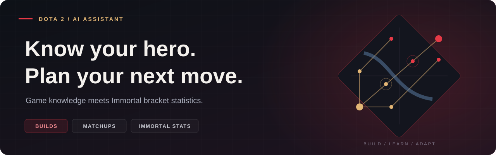
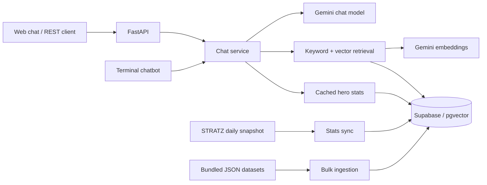

<p align="center">
  
</p>

<h1 align="center">AI Dota 2 Tracker</h1>

<p align="center">
  A Dota 2 assistant that brings hero builds, game knowledge, and Immortal bracket statistics into one chat.
</p>

<p align="center">
  <a href="https://ai-dota-chatbot.vercel.app/"><strong>Try the live demo</strong></a>
  &nbsp;·&nbsp;
  <a href="https://ai-dota-chatbot.vercel.app/docs">API docs</a>
  &nbsp;·&nbsp;
  <a href="#quick-start">Run locally</a>
  &nbsp;·&nbsp;
  <a href="CONTRIBUTING.md">Contribute</a>
</p>

<p align="center">
  <a href="https://github.com/djzap47/ai-dota-chatbot/actions/workflows/ci.yml"></a>
  
  
  
  <a href="LICENSE"></a>
</p>

## What it does

- **Builds by role and game phase.** Ask for starting items, early game, mid game, and late game, with separate paths for heroes that have multiple playstyles.
- **Hero and item knowledge.** Retrieve ability details, Aghanim's upgrades, talents, item recipes, and matchups from the bundled datasets.
- **Immortal bracket statistics.** Sync the latest available daily STRATZ snapshot and query hero win rates and match counts.
- **Hybrid retrieval.** Combine keyword matching with 768-dimensional vector search in PostgreSQL. Keyword search remains available when embeddings fail.
- **Three ways to use it.** A browser chat interface, a documented REST API, and a terminal chatbot share the same response pipeline.
- **Vercel deployment configuration.** The repository includes serverless routing and a daily stats-sync schedule.

The checked-in knowledge snapshot contains **127 heroes**, **159 build variants**, **190 item documents**, and **6 mechanics guides**. The bulk loader compiles these into **450 documents**. These are repository snapshot counts, not a claim that every game patch is already covered.

## Try it

Open the [live demo](https://ai-dota-chatbot.vercel.app/) and try:

| Ask | Explore |
| --- | --- |
| “What should I buy on Faceless Void?” | Alternative build paths |
| “Give me a position 4 Pudge build.” | Role-specific item progression |
| “What does Aghanim's Scepter do on Anti-Mage?” | Hero upgrade knowledge |
| “How do I build Battle Fury?” | Item costs and components |
| “What is Pudge's win rate and match count?” | The latest stored STRATZ statistics |

Chat requests are independent: the browser displays the conversation, but the API sends only the current question to the model. Include the hero and role in each question.

## How it works



The chat service retrieves game knowledge, adds the stored statistics to its system prompt, and makes one Gemini chat call. It uses LangChain's Google integration; it does not ask an SQL agent to write queries. See [architecture and behavior](docs/architecture.md) for the request flow, storage model, and limitations.

## Quick start

You need **Python 3.12+**, a **Supabase PostgreSQL database**, a **Google Gemini API key**, and a **STRATZ API token** for statistics sync. Run the commands below from the repository root.

### 1. Clone and install

```bash
git clone https://github.com/djzap47/ai-dota-chatbot.git
cd ai-dota-chatbot
python -m venv .venv
```

Activate the environment and copy the configuration template:

**Windows PowerShell**

```powershell
.\.venv\Scripts\Activate.ps1
Copy-Item .env.example .env
```

**macOS / Linux**

```bash
source .venv/bin/activate
cp .env.example .env
```

On systems where Python is named `python3`, use `python3 -m venv .venv` to create the environment.

```bash
python -m pip install -r requirements.txt
```

### 2. Configure your services

Edit `.env` using [.env.example](.env.example) as the reference:

| Variable | Purpose |
| --- | --- |
| `SUPABASE_DB_URL` | PostgreSQL connection URI. The template selects `postgresql+psycopg://` for psycopg 3. |
| `GOOGLE_API_KEY` | Gemini chat and embedding requests. |
| `STRATZ_API_KEY` | Fetching hero definitions and Immortal bracket statistics. |
| `CRON_SECRET` | Shared secret for scraper and ingestion routes. **Set this before deploying.** |
| `GEMINI_MODEL` | Chat model; defaults to `gemini-3.5-flash-lite` in [config.py](app/config.py). Choose a model available to your API key. |
| `CHATBOT_TEMPERATURE` | Chat sampling temperature; defaults to `0.7`. |

Copy the transaction pooler connection string from your Supabase project and keep its actual host and username. URL-encode special characters in the password. The application adds `sslmode=require` unless the URI already specifies an SSL mode.

### 3. Initialize and populate the database

Run [schema.sql](schema.sql) in the Supabase SQL Editor. It enables pgvector and creates `heroes`, `hero_stats`, `hero_documents`, and the vector index.

Then load the bundled knowledge and fetch statistics:

```bash
python scripts/bulk_ingest_all_dota_knowledge.py
python scripts/run_scraper.py
```

**The bulk loader replaces all rows in `hero_documents`.** It stores the text first, then attempts to generate embeddings using your Gemini quota. Use a development database when experimenting. You do not need to download the datasets again for the initial setup.

### 4. Start the app

```bash
python -m uvicorn api.index:app --reload --port 8000
```

- Web chat: [localhost:8000](http://localhost:8000/)
- Interactive API docs: [localhost:8000/docs](http://localhost:8000/docs)
- Database connectivity check: [localhost:8000/health](http://localhost:8000/health)

For terminal chat, run `python bot.py` in a separate terminal with the environment activated. The terminal client does not require Uvicorn.

## API at a glance

| Method | Path | Purpose |
| --- | --- | --- |
| `GET` | `/` | Browser chat interface |
| `GET` | `/api/info` | API metadata |
| `GET` | `/health` | Database connectivity status |
| `POST` | `/chat` | Ask a question with `{"message": "..."}` |
| `GET` | `/heroes/top?limit=10` | Highest win rates on the latest stored sync date; limit 1–100 |
| `POST` | `/scraper/run` | Fetch and store STRATZ statistics |
| `GET` | `/api/cron` | Scheduled STRATZ sync |
| `POST` | `/scraper/sync-meta` | Replace the knowledge index from local datasets |

The three scraper routes require `Authorization: Bearer <CRON_SECRET>` when the secret is configured. If it is unset, those routes accept unauthenticated requests. `/scraper/sync-meta` does not download fresh game data.

Example chat request using Python, on any supported shell:

```python
import requests

response = requests.post(
    "http://localhost:8000/chat",
    json={"message": "Give me a position 4 Pudge build."},
    timeout=60,
)
response.raise_for_status()
print(response.json()["reply"])
```

The response contains `reply` and `status` fields. Model output varies; the example questions above are prompts to try, not recorded benchmark results.

## Deploy to Vercel

1. Import your fork into Vercel with the repository root as the project directory.
2. Add the variables from `.env.example`, including a random `CRON_SECRET` and a chat model your key can access.
3. Initialize and populate Supabase using the local setup steps.
4. Deploy with the included [vercel.json](vercel.json), then check `/`, `/docs`, and `/health`.

The configuration routes requests to `api/index.py` and schedules `/api/cron` with `0 0 * * *` (daily at 00:00 UTC). Vercel sends the configured cron secret in the authorization header; see [Vercel's cron documentation](https://vercel.com/docs/cron-jobs/manage-cron-jobs). The cron refreshes **statistics only**. Run bulk ingestion locally because embedding the complete dataset may exceed a function's execution limit.

## Repository map

```text
api/index.py                    FastAPI routes and web entry point
app/
  config.py                     Environment settings
  database.py                   SQLAlchemy engine and sessions
  models.py, schemas.py          Database models and API schemas
  services/                     Chat, retrieval, and STRATZ sync
  templates/index.html          Browser chat UI (HTML, CSS, JavaScript)
  data/                         Bundled game knowledge and build datasets
scripts/                        Ingestion, data refresh, and build generation
tests/                          Offline API, configuration, and data checks
docs/                           Architecture and data-maintenance guides
.github/                        CI workflow and contribution templates
bot.py                          Terminal chat client
schema.sql                      Database initialization
vercel.json                     Deployment routes and cron schedule
```

## Development and data maintenance

```bash
python -m unittest discover -s tests -v
python -m compileall -q api app scripts bot.py
```

The test suite uses local datasets and mocked services; it needs no API keys or running database. GitHub Actions runs the checks on Python 3.12 and 3.14.

Read [CONTRIBUTING.md](CONTRIBUTING.md) for the development workflow and [data maintenance](docs/data-maintenance.md) before running refresh or migration scripts. Some older ingestion scripts use different document or build formats.

## Current limits

- Statistics reflect the latest successful sync, with a 10-minute chat cache. Game knowledge and curated builds can lag behind patches.
- Generated answers can be wrong. Build rules are prompt instructions and heuristics, not a gameplay correctness guarantee.
- There is no player-account tracking, match-history dashboard, persistent chat memory, user authentication, or application-level rate limiting.
- The public chat endpoint uses the deployer's Gemini quota. Service availability and usage limits depend on the configured providers.
- `/health` checks database connectivity only; it does not verify table contents or access to Gemini and STRATZ.

## Credits and license

Game constants come from [OpenDota's dotaconstants](https://github.com/odota/dotaconstants); matchup and popularity scripts use [OpenDota](https://www.opendota.com/). Immortal bracket statistics come from [STRATZ](https://stratz.com/). Additional ingestion scripts support Valve's Dota 2 data feed and Liquipedia.

Project code is available under the [MIT license](LICENSE). Dota 2 belongs to Valve. This is an independent community project; third-party game data and assets remain subject to their respective terms.
