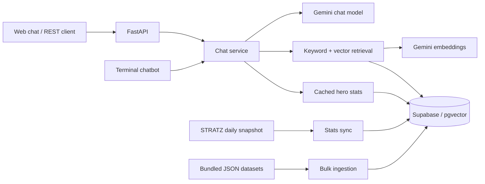

<p align="center">
  
</p>

<h1 align="center">AI Dota 2 Tracker</h1>

<p align="center">
  A Dota 2 assistant that brings hero builds, game knowledge, and Immortal bracket statistics into one chat.
</p>

<p align="center">
  <a href="https://ai-dota-chatbot.vercel.app/"><strong>Try the live demo</strong></a>
  &nbsp;·&nbsp;
  <a href="https://ai-dota-chatbot.vercel.app/docs">API docs</a>
  &nbsp;·&nbsp;
  <a href="#quick-start">Run locally</a>
</p>

<p align="center">
  <a href="https://github.com/djzap47/ai-dota-chatbot/actions/workflows/ci.yml"></a>
  
  
  
  <a href="LICENSE"></a>
</p>

## What it does

- **Builds by role and game phase.** Ask for starting items, early game, mid game, and late game, with separate paths for heroes that have multiple playstyles.
- **Hero and item knowledge.** Retrieve ability details, Aghanim's upgrades, talents, item recipes, and matchups from the bundled datasets.
- **Immortal bracket statistics.** Sync the latest available daily STRATZ snapshot and query hero win rates and match counts.
- **Hybrid retrieval.** Combine keyword matching with 768-dimensional vector search in PostgreSQL. Keyword search remains available when embeddings fail.
- **Three ways to use it.** A browser chat interface, a documented REST API, and a terminal chatbot share the same response pipeline.
- **Vercel deployment configuration.** The repository includes serverless routing and a daily stats-sync schedule.

The checked-in knowledge snapshot contains **127 heroes**, **159 build variants**, **190 item documents**, and **6 mechanics guides**. The bulk loader compiles these into **450 documents**. These are repository snapshot counts, not a claim that every game patch is already covered.

## Try it

Open the [live demo](https://ai-dota-chatbot.vercel.app/) and try:

| Ask | Explore |
| --- | --- |
| “What should I buy on Faceless Void?” | Alternative build paths |
| “Give me a position 4 Pudge build.” | Role-specific item progression |
| “What does Aghanim's Scepter do on Anti-Mage?” | Hero upgrade knowledge |
| “How do I build Battle Fury?” | Item costs and components |
| “What is Pudge's win rate and match count?” | The latest stored STRATZ statistics |

Chat requests are independent: the browser displays the conversation, but the API sends only the current question to the model. Include the hero and role in each question.

## How it works



FastAPI serves the browser interface and API. The chat service retrieves game knowledge from PostgreSQL, adds stored statistics, and makes one Gemini chat call through LangChain's Google integration. There is no frontend build step. If statistics or retrieval are unavailable, the model may answer with less context.

## Quick start

You need **Python 3.12+**, a **Supabase PostgreSQL database**, a **Google Gemini API key**, and a **STRATZ API token** for statistics sync. Run the commands below from the repository root.

### 1. Clone and install

```bash
git clone https://github.com/djzap47/ai-dota-chatbot.git
cd ai-dota-chatbot
python -m venv .venv
```

Activate the environment and copy the configuration template:

**Windows PowerShell**

```powershell
.\.venv\Scripts\Activate.ps1
Copy-Item .env.example .env
```

**macOS / Linux**

```bash
source .venv/bin/activate
cp .env.example .env
```

On systems where Python is named `python3`, use `python3 -m venv .venv` to create the environment.

```bash
python -m pip install -r requirements.txt
```

### 2. Configure your services

Edit `.env` using [.env.example](.env.example) as the reference:

| Variable | Purpose |
| --- | --- |
| `SUPABASE_DB_URL` | PostgreSQL connection URI. The template selects `postgresql+psycopg://` for psycopg 3. |
| `GOOGLE_API_KEY` | Gemini chat and embedding requests. |
| `STRATZ_API_KEY` | Fetching hero definitions and Immortal bracket statistics. |
| `CRON_SECRET` | Shared secret for scraper and ingestion routes. **Set this before deploying.** |
| `GEMINI_MODEL` | Chat model; defaults to `gemini-3.5-flash-lite` in [config.py](app/config.py). Choose a model available to your API key. |
| `CHATBOT_TEMPERATURE` | Sampling temperature, where supported by the model; defaults to `0.7`. |
| `EMBEDDING_MODEL` | Vector model; defaults to `gemini-embedding-2`. Use the same setting for ingestion and queries. |
| `CHAT_REQUESTS_PER_MINUTE` | Shared chat budget across all instances and visitors; defaults to `30`. |
| `CHAT_MAX_CONCURRENT` | Concurrent chat workers per process; defaults to `4`. |
| `UPSTREAM_TIMEOUT_SECONDS` | Timeout per Gemini request; defaults to `20` seconds. |

The last four settings are optional; omitting them uses these defaults. Set `CRON_SECRET` to a random value to enable maintenance endpoints. Keep `.env` local—Vercel reads its own project environment variables.

Copy the transaction pooler connection string from your Supabase project and keep its actual host and username. URL-encode special characters in the password. The application adds `sslmode=require` unless the URI already specifies an SSL mode.

### 3. Initialize and populate the database

Run [schema.sql](schema.sql) in the Supabase SQL Editor. It enables pgvector, creates `heroes`, `hero_stats`, `hero_documents`, and `chat_request_limits`, adds the vector index, and restricts browser-role access to these backend tables.

Then load the bundled knowledge and fetch statistics:

```bash
python scripts/bulk_ingest_all_dota_knowledge.py
python scripts/run_scraper.py
```

**The bulk loader replaces all rows in `hero_documents` in one transaction after validating the datasets.** If insertion fails, the previous index stays intact. It then generates embeddings using your Gemini quota. Use a development database when experimenting. You do not need to download the datasets again for the initial setup.

### 4. Start the app

```bash
python -m uvicorn api.index:app --reload --port 8000
```

- Web chat: [localhost:8000](http://localhost:8000/)
- Interactive API docs: [localhost:8000/docs](http://localhost:8000/docs)
- Database connectivity check: [localhost:8000/health](http://localhost:8000/health)

For terminal chat, run `python bot.py` in a separate terminal with the environment activated. The terminal client does not require Uvicorn.

## API at a glance

| Method | Path | Purpose |
| --- | --- | --- |
| `GET` | `/` | Browser chat interface |
| `GET` | `/api/info` | API metadata |
| `GET` | `/health` | Database connectivity status |
| `POST` | `/chat` | Ask a question with `{"message": "..."}` |
| `GET` | `/heroes/top?limit=10` | Highest win rates on the latest stored sync date; limit 1–100 |
| `POST` | `/scraper/run` | Fetch and store STRATZ statistics |
| `GET` | `/api/cron` | Scheduled STRATZ sync |
| `POST` | `/scraper/sync-meta` | Replace the knowledge index from local datasets |

The three scraper routes require `Authorization: Bearer <CRON_SECRET>`. Missing or blank `CRON_SECRET` disables them with HTTP 503; invalid tokens return HTTP 401. Query-string secrets are not accepted. `/scraper/sync-meta` does not download fresh game data.

Example chat request using Python, on any supported shell:

```python
import requests

response = requests.post(
    "http://localhost:8000/chat",
    json={"message": "Give me a position 4 Pudge build."},
    timeout=60,
)
response.raise_for_status()
print(response.json()["reply"])
```

Successful responses contain `reply` and `status` fields. Chat accepts up to 2,000 characters and a 16 KiB request body. The default deployment-wide budget is 30 requests per minute, backed by PostgreSQL, with four concurrent generation workers per process. HTTP 429 means the budget, concurrency limit, or provider quota was reached; HTTP 503 indicates an unavailable dependency. Failed generation is never returned as a successful reply. Model output varies; the example questions above are prompts to try, not recorded benchmark results.

## Upgrade an existing installation

1. Run [migrations/001_security.sql](migrations/001_security.sql) in the Supabase SQL Editor **before deploying this code**. It adds embedding model metadata, creates the shared chat-budget table, and restricts browser-role access to backend tables. Use a database-owner connection for the backend. New installations get these changes from `schema.sql`.
2. Install the pinned dependencies with `python -m pip install -r requirements.txt`, configure the variables in `.env.example`, and redeploy.
3. Run `python scripts/bulk_ingest_all_dota_knowledge.py` locally to rebuild the knowledge index and tag vectors with `EMBEDDING_MODEL`. Existing untagged vectors are excluded from semantic search; their text remains available to keyword search.

The application does not run migrations automatically. Chat returns HTTP 503 if the budget table is missing or inaccessible. Changing `EMBEDDING_MODEL` also requires rebuilding the index; vectors from different models are not compared.

## Deploy to Vercel

1. Import your fork into Vercel with the repository root as the project directory.
2. Add the variables from `.env.example`, including a random `CRON_SECRET` and a chat model your key can access.
3. Initialize and populate Supabase using the local setup steps.
4. Deploy with the included [vercel.json](vercel.json), then check `/`, `/docs`, and `/health`.

The configuration routes requests to `api/index.py` and schedules `/api/cron` with `0 0 * * *` (daily at 00:00 UTC). Vercel sends the configured cron secret in the authorization header; see [Vercel's cron documentation](https://vercel.com/docs/cron-jobs/manage-cron-jobs). The cron refreshes **statistics only**. Run bulk ingestion locally because embedding the complete dataset may exceed a function's execution limit.

## Working on the project

```bash
python -m unittest discover -s tests -v
python -m compileall -q api app scripts bot.py
git diff --check
```

Offline tests use local datasets and mocked services, requiring no API keys. GitHub Actions runs them on Python 3.12 and 3.14, audits the dependency lock, and runs PostgreSQL/pgvector integration tests for rollback, concurrent rate limiting, model isolation, and RLS. Those integration tests are skipped locally unless `TEST_DATABASE_URL` points to a disposable database named `dota_test`.

For dependency updates, edit `requirements.in`, regenerate the pinned `requirements.txt` with uv, then reinstall and run the checks above:

```bash
uv pip compile requirements.in --universal --python-version 3.12 --upgrade --output-file requirements.txt
python -m pip install -r requirements.txt
python -m pip check
```

Read [data maintenance](docs/data-maintenance.md) before refreshing datasets or rebuilding the index. It explains which scripts overwrite files or replace database contents. For bugs or incorrect answers, open an issue with the question, result, and steps to reproduce. Keep API keys and database credentials out of reports.

## Current limits

- Statistics reflect the latest successful sync, with a 10-minute chat cache. Game knowledge and curated builds can lag behind patches.
- Generated answers can be wrong. Build rules are prompt instructions and heuristics, not a gameplay correctness guarantee.
- There is no player-account tracking, match-history dashboard, persistent chat memory, or user authentication. Chat has a shared request budget rather than individual user quotas.
- The public chat endpoint uses the deployer's Gemini quota. Its request budget is shared across all visitors, so one caller can use it up. It is not a monthly spending cap; configure provider spending limits separately.
- `/health` checks database connectivity only; it does not verify table contents or access to Gemini and STRATZ.

## Credits and license

Game constants come from [OpenDota's dotaconstants](https://github.com/odota/dotaconstants); matchup and popularity scripts use [OpenDota](https://www.opendota.com/). Immortal bracket statistics come from [STRATZ](https://stratz.com/). Additional ingestion scripts support Valve's Dota 2 data feed and Liquipedia.

Project code is available under the [MIT license](LICENSE). Dota 2 belongs to Valve. This is an independent community project; third-party game data and assets remain subject to their respective terms.
